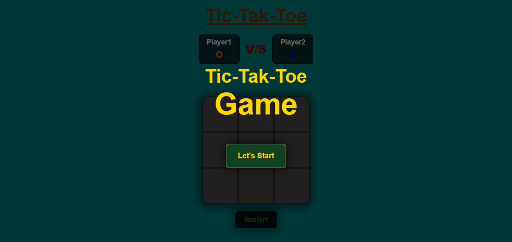
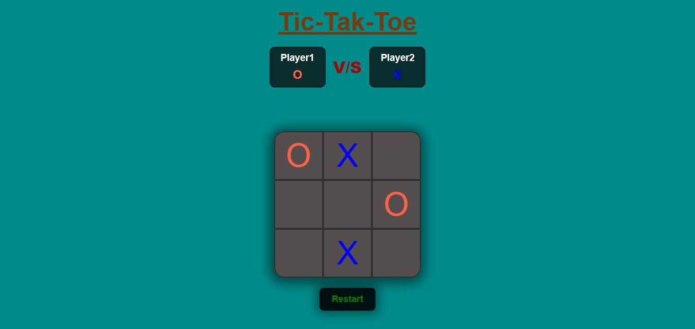
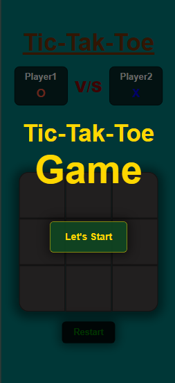
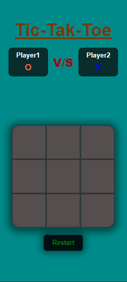
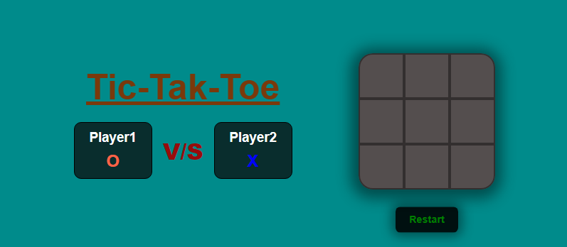

# 🎮 Tic-Tac-Toe

A simple, interactive and responsive **Tic-Tac-Toe game** built with **HTML, CSS and JavaScript**.

This project was created as a practice project to improve my frontend development skills, especially **JavaScript game logic, DOM manipulation, event handling and responsive UI design**.

## 🚀 Live Demo

🎮 **Play the Game:**
https://abdulrahman1919.github.io/Tic-Tac-Toe/

## 📸 Screenshots

### 💻 Desktop View

#### Home:



#### Game:



### 📱 Mobile View

#### Home:



#### Game:



#### Game Landscap:



## ✨ Features

* 🎮 Two-player Tic-Tac-Toe game
* ❌ X and ⭕ O player turns
* 🏆 Automatic winner detection
* 🔄 Reset game functionality
* 🆕 New Game option
* 🎨 Clean and simple user interface
* 📱 Responsive design
* ⚡ Fast and lightweight
* 🌐 Runs directly in the browser

## 🛠️ Technologies Used

* **HTML5** — Game structure
* **CSS3** — Styling and responsive layout
* **JavaScript** — Game logic and interactivity

## 🧠 What I Practiced

Through this project, I practiced:

* DOM manipulation
* JavaScript event listeners
* Conditional logic
* Arrays
* Winning pattern detection
* Button state management
* CSS Flexbox
* Responsive web design
* Basic game development logic

## 🎯 How to Play

1. Click **Start Game**.
2. The first player places **O**.
3. The second player places **X**.
4. Players take turns selecting empty cells.
5. Get three matching symbols in a row, column or diagonal to win.
6. Use **New Game** or **Reset** to play again.

## 📂 Project Structure

```text
Tic-Tac-Toe/
│
├── index.html
├── tic-tac-toe.css
├── tic-tac-toe.js
│
└── screenshots/
    ├── desktop.png
    └── mobile.png
```

## 🔗 Repository

**GitHub Repository:**
https://github.com/abdulrahman1919/Tic-Tac-Toe

## 👨‍💻 Author

**Abdul Rahman Amin**

GitHub:
https://github.com/abdulrahman1919

---

⭐ If you like this project, feel free to give it a star!

Made with ❤️ using **HTML, CSS & JavaScript**
